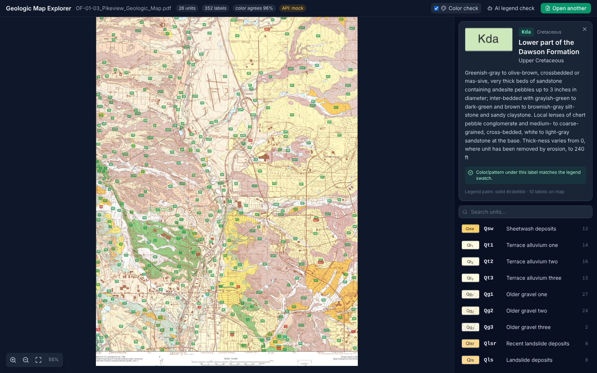

# Geologic Map Explorer

Turn a geologic map PDF into an interactive map: click any unit label (Qsw,
Kda, Qt₁…) to see the unit's name, age, description and legend swatch, or click
anywhere to identify the unit by its color/pattern.



## How it works

Modern map PDFs (anything made in Illustrator/ArcMap since ~2000) carry far
more structure than pixels. We read it directly:

```
PDF ─┬─ text layer ──────► positioned words (+ fonts → bold detection)
     │                        │
     └─ drawing commands ──► filled shapes with their paint (solid color or pattern tile)
                              │
        legend entries  ◄─────┤  code inside a small rectangle + bold "Name (Age)—" to its right
        map labels      ◄─────┤  legend codes found inside the map frame
        color check     ◄─────┘  paint under each label == paint of its legend swatch?
```

On the Pikeview test map that gives **26/26 legend units** (names, ages,
descriptions, parent/group structure), **352 map labels**, and **~96%** of
labels whose color/pattern agrees with their text, with no AI and no OCR.
Scanned maps fall back to OCR + Claude (via our own API server, so the key
never reaches the browser).

Color/pattern matching is deliberately isolated in
[`src/lib/color/`](src/lib/color/README.md) with its own workbench
(`npm run color:lab`), so it can be iterated on alone.

## Quick start

See **[docs/HOST_SETUP.md](docs/HOST_SETUP.md)** for the one-time Windows
setup (VS Code settings, private folder, first push). Then, in the dev container:

```bash
npm run dev          # http://localhost:5173 (forwarded to your PC)
```

and drop in `fixtures/pikeview/OF-01-03_Pikeview_Geologic_Map.pdf`.

| Command | What |
|---|---|
| `npm run dev` | Vite + API server (mock mode) |
| `npm test` | Unit, golden-fixture and API tests (vitest) |
| `npm run test:e2e` | Playwright: real UI in headless Chromium against the mock API |
| `npm run lint` / `npm run build` | ESLint / production build |
| `npm run parse -- <pdf>` | Parse from the CLI, print legend + stats |
| `npm run color:lab -- <pdf>` | Color workbench: accuracy for both strategies + debug images |

## Testing strategy

| Layer | Question it answers | Where |
|---|---|---|
| Unit tests | Does each piece of logic work? (code shapes, hyphenation, geometry, color math, leader lines) | `tests/unit/` |
| Golden fixture | Does the whole pipeline still get a real map right? Compared against hand-checkable `expected-units.json` (names cross-checked against an independent PDF extractor) | `tests/fixtures/` |
| API tests | Mock/live modes, input validation, **the key never appears in responses or logs** | `tests/server/` |
| End-to-end | Does the real UI work in a browser? | `tests/e2e/` |
| AI evals (manual) | Is the *model* reading legends correctly? Run with the live key; "AI legend check" in the UI compares AI vs text parse | `api-real` |

Mocks prove our code handles AI responses; they can't prove the AI is
*right*. That's what the live, manual evals are for.

## Dev environment and security model

Dev container with Claude Code, based on a stricter container used for
sensitive data, relaxed for public data but still isolated:

- **Only this project is mounted**: no home folder, SSH keys, or Docker socket.
- **Default-deny egress firewall**: Anthropic + npm registry only. GitHub is
  blocked; you push from your PC.
- **No secrets in the container**: the API server runs in mock mode. The real
  key lives in a private folder mounted only into the opt-in `api-real` service.
- **Claude can commit, not push.** Anything your PC later *executes*
  (`.devcontainer/`, `.git/config`, `.git/hooks/`, `scripts/host/`) is read-only
  inside the container, checked at startup and again by `safe-push.ps1`.

Details and the threat table: [docs/HOST_SETUP.md](docs/HOST_SETUP.md#what-protects-what).

## Project layout

See [CLAUDE.md](CLAUDE.md#layout).

## Known limitations

- Legend entries whose description continues into the next column are cut at
  the column bottom (Pikeview: facies unit one).
- Entries with lowercase codes (`af`, artificial fill) aren't recognized as units yet.
- Raster (pixel) color matching is a baseline (~56% on Pikeview); vector
  matching is the reliable path for modern PDFs.
- The scanned-map path (OCR + AI) is untested: we need a scanned fixture.
- Some soft-hyphen artifacts from the source PDF survive when a word appears
  only once in the document (e.g. "lith-ologies").

## Roadmap (DevOps practice)

- [ ] GitHub Actions CI: lint, unit tests, build, Playwright (cache npm + browsers)
- [ ] Production image: multi-stage Dockerfile (build with Node → serve `dist/` with nginx + the API)
- [ ] Dependabot + `npm audit` gate; image scanning (Trivy)
- [ ] Tailwind 4 migration (clears the remaining dev-only `npm audit` advisory)
- [ ] More fixtures: an older map, a scanned map
- [ ] Deploy (and a backend that never exposes the key)
